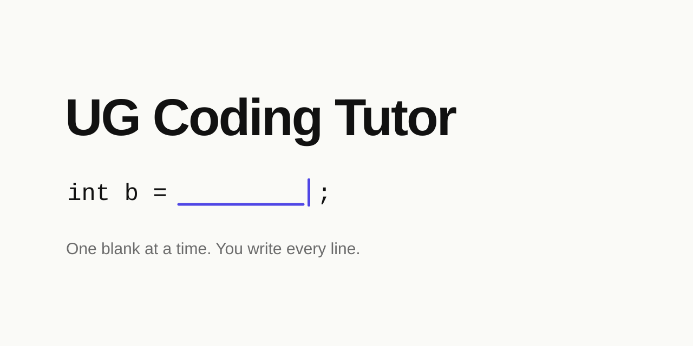

<p align="center">
  
</p>

<p align="center">
  <b>UG Coding Tutor</b> (Undergraduate Coding Tutor) is a Socratic agent skill that teaches students to write code themselves.<br>
  It asks one question per blank and never writes the code for you.
</p>

<p align="center">
  <a href="#install">Install</a> ·
  <a href="#how-it-works">How it works</a> ·
  <a href="skills/undergraduate-coding-tutor/SKILL.md">Read the skill</a> ·
  <a href="LICENSE">MIT</a>
</p>

---

## Why

Hand a student the full solution and they copy it, look "90% done", and learn nothing.
Hand them seven corrections at once and they shut down.

UG Coding Tutor takes the slow road on purpose: **you write every line, and the tutor only makes the next step small enough to take.**

## How it works

**One blank per message.** Each question is small enough to answer in one step: first *what does one thread own?*, then *how many are there?*

**Numbers, not lectures.** When an answer is wrong, the tutor names just one mistake and plugs in concrete values, so you can see your formula break.

**You type, it reads.** The tutor never edits your files. When you say "done", it opens the file and checks what you actually wrote.

```text
you    : walk me through this histogram kernel
tutor  : Threads launch in whole blocks, so some are extra. What should
         the thread with idx == N do? Fill the guard:
           if (______) {
you    : done
tutor  : (reads your file) ✔ Right bound.
         Next: threads 5 and 9 both add 1 to hist[100], which is 7.

           | t | thread 5 | thread 9 | hist[100] |
           | 1 | read 7   |          |     7     |
           | 2 |          | read 7   |     7     |
           | 3 | write 8  | write 8  |   **8**   |  ← one count lost

         That's why we need atomicAdd. Fill line 27:
           atomicAdd(______, ______);
```

| When you… | The tutor… |
|---|---|
| get it right | says ✔ and why in one line, then moves on |
| get it wrong | says what's right first, names one mistake, and shows it with numbers |
| say "I don't know" | makes the question smaller, then hands you an easier blank with the same shape |
| say "done" | reads your file before replying |
| say "just give me all of it" | gives the full code with a comment on every line, which you type in yourself |
| finish | puts together the code you wrote and lists the traps you hit |

It also has a built-in table of **common mix-ups** for diagnosing mistakes: off-by-one, position vs. size, base case vs. recursive case, copy vs. alias, mutating while iterating, and names copied over from another function, plus a set for systems and GPU courses.

## Install

**As a Claude Code plugin**

```text
/plugin marketplace add YJLi-new/undergraduate-coding-tutor
/plugin install undergraduate-coding-tutor@undergraduate-coding-tutor
```

**Or copy the skill folder**

```bash
git clone https://github.com/YJLi-new/undergraduate-coding-tutor.git
```

```bash
cp -r undergraduate-coding-tutor/skills/undergraduate-coding-tutor ~/.claude/skills/
```

Then say *"walk me through it"*, *"step by step"*, or *"I can only think one step"*, or paste a problem you're stuck on. If you just want the answer, ask for it and the tutor will give it.

## Who it's for

- Students in any course where you write the code yourself: intro programming, data structures, algorithms, systems, GPU/CUDA
- Anyone preparing for fill-in-the-blank or write-the-function exams
- TAs who want AI help that doesn't hand out solutions

## Layout

```text
.claude-plugin/        plugin + marketplace manifests
skills/
  undergraduate-coding-tutor/
    SKILL.md           the skill
assets/hero.svg
LICENSE
```

## A note on academic integrity

This skill is built to help students learn, not to do their work for them. If your course has rules about AI tools, such as disclosing that you used one, follow them.

## License

[MIT](LICENSE) © YJLi-new
